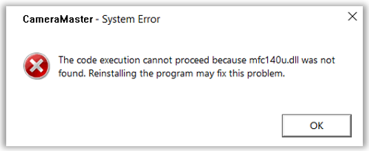
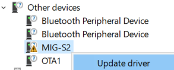
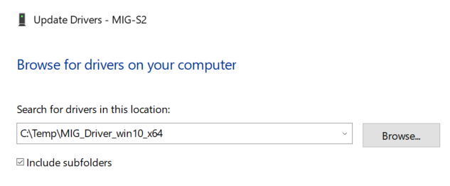
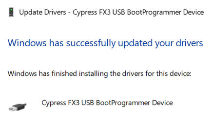
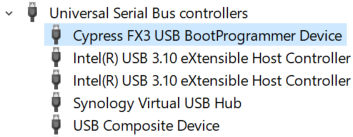
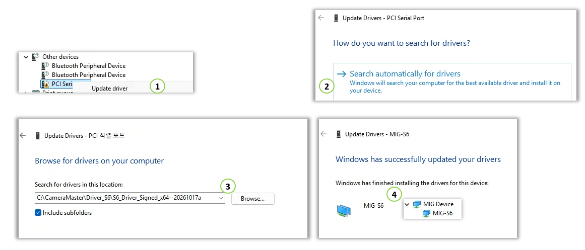

# Driver Installation

Check the model label before selecting a package. See [Downloads](Downloads.md) for the available package names and platform labels.

> Package names below identify Windows 10 x64 (S2) and Windows 11 x64 (S6). Compatibility with other operating systems or board revisions must be confirmed with support.

## Before installation

1. Record your board model, hardware revision and Windows version/architecture.
2. Install the required Visual C++ runtime, then follow the instructions for your model.
3. Check Device Manager for the board and any warning symbols after installation.
4. Open [CameraMaster](CameraMaster.md) and check the grabber connection status.

If installation fails, record the Device Manager error code and follow [Troubleshooting](Troubleshooting.md).

## Visual C++ Redistributable for Visual Studio 2015\~2022

Install “[Visual C++ Redistributable for Visual Studio 2015\~2022](https://cizentech-my.sharepoint.com/:u:/p/mason/EVMhVvG3-CtCtEEtHW4ev9wB4d4AobfjBobrFZFd4BxH6Q?e=UaIyb8)”

## MIG-S2 Driver Installation

[Install the MIG_Driver_win10_x64 package](https://cizentech-my.sharepoint.com/:u:/p/mason/Ed_I9q-3fPpAj6ca6SkHVgQBklY5Z7CpYuXBG8GC3qJv5g?e=32tdgL)

[Install the MIG_Driver_Signed_win10_x64 package](https://cizentech-my.sharepoint.com/:u:/p/mason/IQC4hKMwUkK8RqKFQMzbpdFLAbJAgNGdMvui6NOEu65JURM?e=oVpVPX)

## MIG-S3 Driver Installation

> The MIG-S3 installation package and verified steps are not yet published here. Contact [technical support](Technical_Support.md) with the board revision and OS details to obtain the appropriate instructions. Do not substitute the S2 or S6 package without confirmation.

## MIG-S6 Driver Installation

[Install the S6_Driver_Signed_win11_x64 package](https://cizentech-my.sharepoint.com/:u:/p/mason/IQBGqKYR8wYHRJmiOj2T58_qAWxyLolqxD2JOQ0vTAeOGQw?e=4gxlac)

