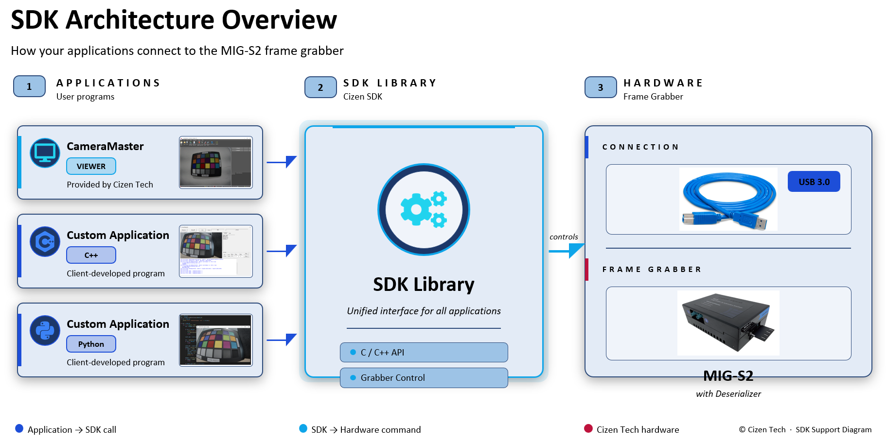
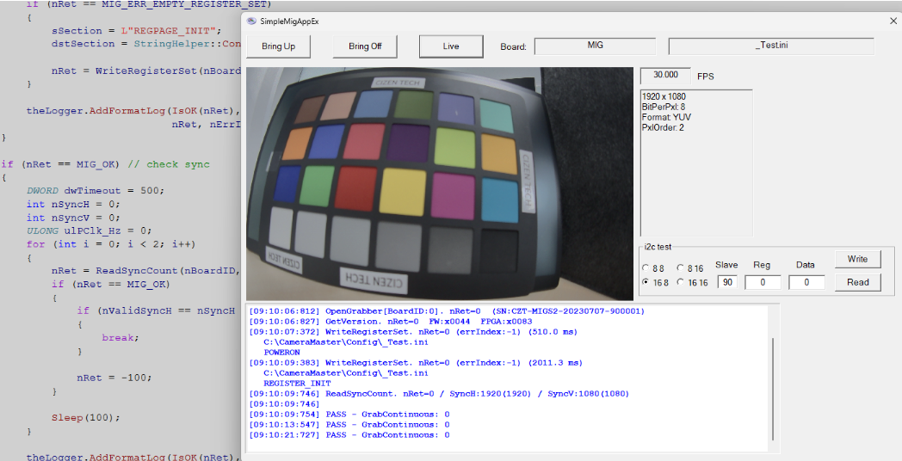
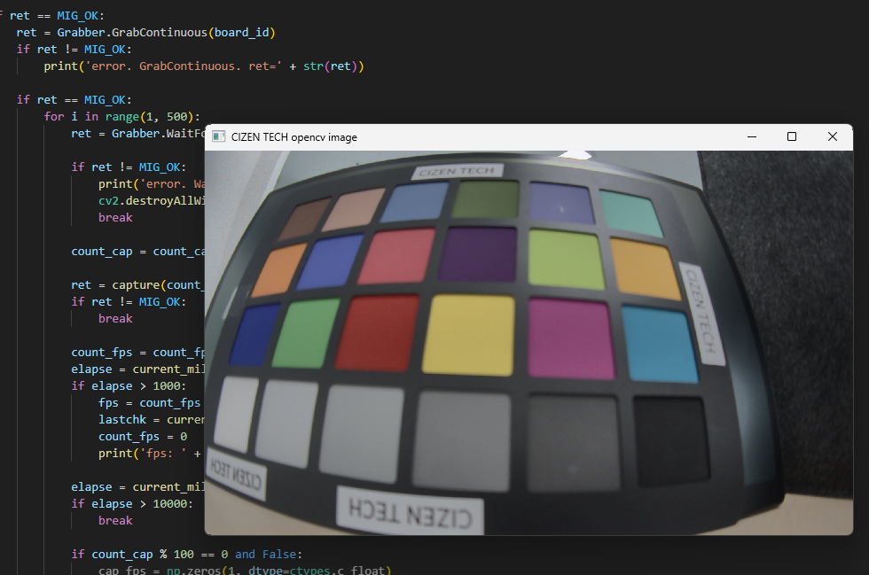
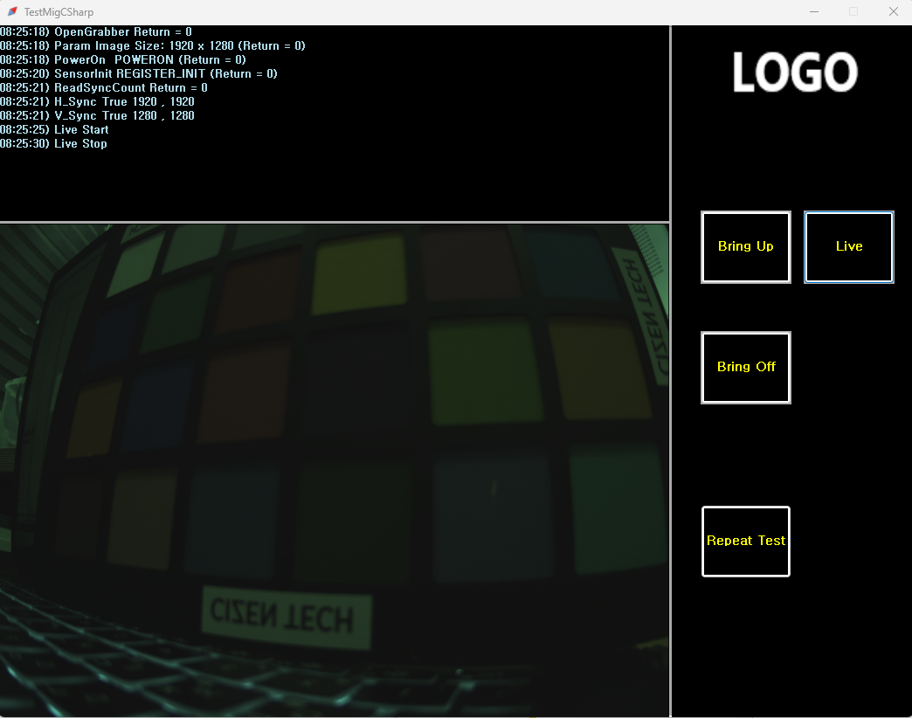

# MIG Grabber SDK

We provide a SDK (API) so that users can control the grabber through their own programs.

-   SDK (Software Development Kit)
-   API (Application Programming Interface)

[SDK (migGrabber.dll) library](https://cizentech-my.sharepoint.com/:u:/p/mason/IQALGjOZzjR2QqCCB25r8L4EASPM0SLJJFcOpntc58ZOMQA?e=ZCtpBu)



## API List

Use the sidebar or search to jump to a function. Declarations below are retained from the published SDK reference; consult the headers supplied with your SDK version for authoritative types and supported models.

### GetMigSdkVersion

Get the version of MIG SDK.

```cpp
/**
 * @brief Get the version of MIG SDK.
 *
 * @return int
 */
extern int              GetMigSdkVersion();
```

### EnumerateBoard

Get the list of connected boards.

```cpp
/**
 * @brief Get the list of connected boards.
 *
 * @param pDest
 * @return #MIG_OK\n #MIG_ERR
 * @see _BOARD_LIST
 */
extern int              EnumerateBoard(_BOARD_LIST* pDest);
```

### GetNumOfBoard

Get the number of connected boards.

```cpp
/**
 * @brief Get the number of connected boards.
 *
 * @return Gets the number of connected boards.
 */
extern int              GetNumOfBoard();
```

### GetBoardId

Get the board id by the usb index.

```cpp
/**
 * @brief Get the board id by the usb index.
 *
 * @param nUsbIndex usb index
 * @return Board id : 0, 1, 2,, (-1: invalid usb index)
 */
extern int              GetBoardId(int nUsbIndex);
```

### GetErrStr

Get the error string.

```cpp
/**
 * @brief Get the error string.
 *
 * @param nErrCode error code
 * @param pBuff string buffer to get result
 * @param sizeBuff buffer size
 */
extern void             GetErrStr(int nErrCode, char* pBuff, int sizeBuff);
```

### SetParamInt

Set the parameter.

```cpp
/**
 * @brief Set the parameter.
 *
 * @param BoardId ID to control
 * @param type #MIG_PARAM_VIDEO_FMT
 * @param val parameter value
 * @return #MIG_OK\n #MIG_ERR_INVALID_PARAMETER\n #MIG_ERR_GRABBER_NOT_OPENED
 */
extern int              SetParamInt(int BoardId, int type, int val);
```

### GetParamInt

Get the parameter.

```cpp
/**
 * @brief Get the parameter.
 *
 * @param BoardId ID to control
 * @param type #MIG_PARAM_VIDEO_FMT
 * @return parameter value
 */
extern int              GetParamInt(int BoardId, int type);
```

### OpenGrabber

Open Grabber board.

```cpp
/**
 * @brief Open Grabber board.
 *
 * @param BoardId ID to control
 * @param nGrabberType 1:S2
 * @param hwndParent handle of parent window (nullable)
 * @return #MIG_OK\n #MIG_ERR
 */
extern int              OpenGrabber(int BoardId, int nGrabberType, MIG_HANDLE hwndParent);
```

### SetConfigPathName

Set the config path name.

```cpp
/**
 * @brief Set the config path name.
 *
 * @param BoardId ID to control
 * @param pConfigFilePath config path
 */
extern void             SetConfigPathName(int BoardId, const char* pConfigFilePath);
```

### CloseGrabber

Close Grabber board.

```cpp
/**
 * @brief Close Grabber board.
 *
 * @param BoardId ID to control
 * @return #MIG_OK\n #MIG_ERR
 */
extern int              CloseGrabber(int BoardId);
```

### IsGrabberOpened

Query that Grabber is opened.

```cpp
/**
 * @brief Query that Grabber is opened.
 *
 * @param BoardId ID to control
 * @return TRUE. grabber is opened / FALSE
 */
extern BOOL             IsGrabberOpened(int BoardId);
```

### GetGrabberType

Get the Grabber Type.

```cpp
/**
 * @brief Get the Grabber Type.
 *
 * @param BoardId ID to control
 * @return Grabber Type.
 */
extern int              GetGrabberType(int BoardId);
```

### GetSerialNo

Get the Serial Number.

```cpp
/**
 * @brief Get the Serial Number.
 *
 * @param BoardId ID to control
 * @param pSn string buffer to get SN
 * @param sizeSN buffer size
 * @return #MIG_OK\n #MIG_ERR\n #MIG_ERR_INTERFACE_NOT_IMPLEMENTED
 */
extern int              GetSerialNo(int BoardId, char* pSn, int sizeSN);
```

### IsVirtual

Query that Grabber is virtual mode.

```cpp
/**
 * @brief Query that Grabber is virtual mode.
 *
 * @param BoardId ID to control
 * @return TRUE. sdk is virtual mode / FALSE
 */
extern BOOL             IsVirtual(int BoardId);
```

### Grab

Captures the specified number of frames.

```cpp
/**
 * @brief Captures the specified number of frames.
 *
 * @param BoardId ID to control
 * @param nNbImage number of grab-image. normally that is 1. (over 1: average images)
 * @param dwTimeOut_ms command timeout (millisecond)
 * @return #MIG_OK\n #MIG_ERR_GRAB_IN_PROGRESS
 */
extern int              Grab(int BoardId, int nNbImage, DWORD dwTimeOut_ms);
```

### GrabContinuous

Start capturing image.

```cpp
/**
 * @brief Start capturing image.
 *
 * @param BoardId ID to control
 * @return #MIG_OK\n #MIG_ERR_GRAB_IN_PROGRESS
 * @see WaitForFrameDone()
 */
extern int              GrabContinuous(int BoardId);
```

### GrabInProgress

Query that Grab is in progress.

```cpp
/**
 * @brief Query that Grab is in progress.
 *
 * @param BoardId ID to control
 * @return BOOL
 */
extern BOOL             GrabInProgress(int BoardId);
```

### HaltGrab

Stop capturing image.

```cpp
/**
 * @brief Stop capturing image.
 *
 * @param BoardId ID to control
 * @return #MIG_OK\n #MIG_ERR
 */
extern int              HaltGrab(int BoardId);
```

### WaitForFrameDone

Wait for new frame.

```cpp
/**
 * @brief Wait for new frame.
 *
 * @param BoardId ID to control
 * @param dwTimeOut_ms timeout for waiting new frame (millisecond)
 * @return #MIG_OK\n #MIG_ERR_GRAB_TIMEOUT
 * @see GrabContinuous()
 */
extern int              WaitForFrameDone(int BoardId, DWORD dwTimeOut_ms);
```

### GetImage

Get image data.

```cpp
/**
 * @brief Get image data.
 *
 * @param BoardId ID to control
 * @param pDstBuffer Destination buffer to get image data
 * @param dstWidth image width
 * @param dstHeight image height
 * @param dstPitchBytes pitch bytes
 * @return #MIG_OK\n #MIG_ERR
 */
extern int              GetImage(int BoardId, unsigned char* pDstBuffer, int dstWidth, int dstHeight, int dstPitchBytes);
```

### i2cRead

Read i2c data.

```cpp
/**
 * @brief Read i2c data.
 *
 * @param BoardId ID to control
 * @param wRegAddr Register address
 * @param pbytValue Register read buffer
 * @param nLength read length
 * @return #MIG_OK\n #MIG_ERR
 */
extern int              i2cRead(int BoardId, unsigned short wRegAddr, BYTE* pbytValue, int nLength);
```

### i2cWrite

Write i2c data.

```cpp
/**
 * @brief Write i2c data.
 *
 * @param BoardId ID to control
 * @param wRegAddr Register address
 * @param pbytValue Register data
 * @param nLength data length
 * @return MIG_OK
 * @see MIG_ERR_I2C_NO_ACK_DEV_ADDR
 */
extern int              i2cWrite(int BoardId, unsigned short wRegAddr, BYTE* pbytValue, int nLength);
```

### bulk_i2cReset

Reset bulk i2c buffer data.

```cpp
/**
 * @brief Reset bulk i2c buffer data.
 *
 * @param BoardId ID to control
 * @return #MIG_OK\n #MIG_ERR
 */
extern int              bulk_i2cReset(int BoardId);
```

### bulk_i2cSet

Add i2c data into bulk buffer.

```cpp
/**
 * @brief Add i2c data into bulk buffer.
 *
 * @param BoardId ID to control
 * @param wRegAddr Register address
 * @param pbytValue Register data
 * @param nLength data length
 * @return #MIG_OK\n #MIG_ERR
 */
extern int              bulk_i2cSet(int BoardId, unsigned short wRegAddr, BYTE* pbytValue, int nLength);
```

### bulk_i2cSetDelay

Add delay data into bulk buffer.

```cpp
/**
 * @brief Add delay data into bulk buffer.
 *
 * @param BoardId ID to control
 * @param wDelay_ms
 * @return #MIG_OK\n #MIG_ERR
 */
extern int              bulk_i2cSetDelay(int BoardId, WORD wDelay_ms);
```

### bulk_i2cRun

Execute bulk i2c buffer data.

```cpp
/**
 * @brief Execute bulk i2c buffer data.
 *
 * @param BoardId ID to control
 * @return #MIG_OK\n #MIG_ERR
 */
extern int              bulk_i2cRun(int BoardId);
```

### pwrSetVoltage

Power on the specified power channel.

```cpp
/**
 * @brief Power on the specified power channel.
 *
 * @param BoardId ID to control
 * @param nPwrChannel power channel 0, 1, 2,,,
 * @param nPwrLevel_mV power level (mili voltage)
 * @return #MIG_OK\n #MIG_ERR
 */
extern int              pwrSetVoltage(int BoardId, int nPwrChannel, const int nPwrLevel_mV);
```

### pwrMeasureVoltage

Measure voltage on specified power channel.

```cpp
/**
 * @brief Measure voltage on specified power channel.
 *
 * @param BoardId ID to control
 * @param nPwrChannel power channel 0, 1, 2,,,
 * @param pPwrResult_mV
 * @return #MIG_OK\n #MIG_ERR
 */
extern int              pwrMeasureVoltage(int BoardId, int nPwrChannel, int* pPwrResult_mV);
```

### pwrMeasureCurrent

Measure current on specified power channel.

```cpp
/**
 * @brief Measure current on specified power channel.
 *
 * @param BoardId ID to control
 * @param nPwrChannel power channel 0, 1, 2,,,
 * @param pPwrResult_mA
 * @return #MIG_OK\n #MIG_ERR
 */
extern int              pwrMeasureCurrent(int BoardId, int nPwrChannel, int* pPwrResult_mA);
```

### WriteRegisterSet

Apply power or Sensor init configuration.  ex> [POWERON] [REGISTER_INIT]

```cpp
/**
 * @brief Apply power or Sensor init configuration.  ex> [POWERON] [REGISTER_INIT]
 *
 * @param BoardId ID to control
 * @param pFile file name of sensor init
 * @param pSection section name of sensor init
 * @param pnErrorIndex if error, error line number
 * @return #MIG_OK\n #MIG_ERR_EMPTY_REGISTER_SET\n #MIG_ERR_I2C_NO_ACK_DEV_ADDR\n #MIG_ERR_INVALID_COMMAND
 */
extern int              WriteRegisterSet(int BoardId, const char* pFile, const char* pSection, int* pnErrorIndex);
```

### ReadSyncCount

Read sync count to check module output.

```cpp
/**
 * @brief Read sync count to check module output.
 *
 * @param BoardId ID to control
 * @param dwTimeOut_ms timeout for waiting valid sync
 * @param pDestHsync count of Horizontal sync
 * @param pDestVsync count of Vertical sync
 * @param pDestPClk_Hz count of PCLK
 * @return #MIG_OK\n #MIG_ERR_TIMEOUT_READSYNC
 */
extern int              ReadSyncCount(int BoardId, DWORD dwTimeOut_ms, int* pDestHsync, int* pDestVsync, ULONG* pDestPClk_Hz);
```

## C++ Sample code



```cpp
// Dynamically Load API from SDK library
sFile.Format(_T("%s\\migGrabber.dll"), Helper::GetCurrentProcessPath());

HMODULE hSdk = LoadLibrary(sFile);
if (hSdk)
{
	SetParamInt = (_SetParamInt)GetProcAddress(hSdk, "SetParamInt");
	GetParamInt = (_GetParamInt)GetProcAddress(hSdk, "GetParamInt");
	SetParamDouble = (_SetParamDouble)GetProcAddress(hSdk, "SetParamDouble");
	GetParamDouble = (_GetParamDouble)GetProcAddress(hSdk, "GetParamDouble");

	GetNumOfBoard = (_GetNumOfBoard)GetProcAddress(hSdk, "GetNumOfBoard");
	GetBoardId = (_GetBoardId)GetProcAddress(hSdk, "GetBoardId");

	EnumerateBoard = (_EnumerateBoard)GetProcAddress(hSdk, "EnumerateBoard");

	OpenGrabber = (_OpenGrabber)GetProcAddress(hSdk, "OpenGrabber");
}

// Open Grabber System
nRet = OpenGrabber(nBoardID, MIG_GRABBER_S1, NULL);

// Setup Grabber board with Test Image config
nRet = SetParamInt(nBoardID, MIG_PARAM_VIDEO_FMT, video_format);
nRet = SetParamInt(nBoardID, MIG_PARAM_PIXEL_ORDER, pxl_order);
nRet = SetParamInt(nBoardID, MIG_PARAM_HOR_RES, width);
nRet = SetParamInt(nBoardID, MIG_PARAM_VER_RES, height);
nRet = SetParamInt(nBoardID, MIG_PARAM_BITS_PER_PIXEL, bitPerPxl);

// Send sensor power on config set
// [POWERON]
// PWR 1 8
// PWR 2 8
// DELAY 300

sFile.Format(_T("%s\\Test.ini"), Helper::GetCurrentProcessPath());
nRet = WriteRegisterSet(nBoardID, sFile, "POWERON", &nErrIndex);

// Send sensor initial config set
// [REGISTER_INIT]
// BOARD_PRESET RESET
// adddevadr x90 400 1 0 / Des
// adddevadr x80 400 1 0 / Ser
// adddevadr x36 400 1 0 / Sensor
// devadr x90
// x0010 x81 /reset_all
// DELAY 150
// x0001 x02 /RX_RATE[1:0] def:x01(3Gbps) x02(6Gbps)
// x0313 x00 /CSI out Disable

sFile.Format(_T("%s\\Test.ini"), Helper::GetCurrentProcessPath());
nRet = WriteRegisterSet(nBoardID, sFile, "REGISTER_INIT", &nErrIndex);

// Read Image Data Sync Count (to check image data validation)
nRet = ReadSyncCount(nBoardID, dwTimeout, &nSyncH, &nSyncV, &ulPClk_Hz);

// Capture Image in Grabber and copy image data from Grabber board to application.
nRet = Grab(nBoardID, 1, 1000);
if (nRet == MIG_OK)
{
	nRet = GetImage(nBoardID, m_vBuff[0], m_nWidth, m_nHeight, m_nLineBytes);
}

// i2c write and read function
nRet = i2cWrite(nBoardID, reg, data, nLen);
nRet = i2cRead(nBoardID, reg, data, nLen);
```

## Python Sample code

> Integration excerpt, not a standalone application. The SDK package must supply matching constants and ctypes declarations (argtypes/restype and calling convention). Open the board first; initialize the configuration path, image dimensions, buffers and output pointers before running this excerpt. Match Python architecture to the DLL. Check every return code and close the board in your application's cleanup path. Hardware execution and ABI compatibility are not verified by this documentation's syntax check.



```python
# Use the Grabber binding initialized by the matching SDK sample.
# Load migGrabber.dll using an absolute path, for example:
# Path(__file__).resolve().parent / "migGrabber.dll"
# Configure the calling convention and all ctypes prototypes before calling it.

# Setup Grabber board with Test Image config
ret = Grabber.SetParamInt(board_id, MIG_PARAM_VIDEO_FMT, video_format)
ret = Grabber.SetParamInt(board_id, MIG_PARAM_PIXEL_ORDER, pixel_order)
ret = Grabber.SetParamInt(board_id, MIG_PARAM_HOR_RES, width)
ret = Grabber.SetParamInt(board_id, MIG_PARAM_VER_RES, height)

# Send sensor power on config set
poweron_section = 'POWERON'
ret = Grabber.WriteRegisterSet(board_id, file_config.encode('utf-8'), poweron_section.encode('utf-8'), 0)

# Send sensor initial config set
init_section = 'REGISTER_INIT'
ret = Grabber.WriteRegisterSet(board_id, file_config.encode('utf-8'), init_section.encode('utf-8'), 0)

# Read Image Data Sync Count (to check image data validation)
ret = Grabber.ReadSyncCount(board_id,1000, pHsync, pVsync, 0)

# Capture Image in Grabber and copy image data from Grabber board to application.
ret = Grabber.Grab(board_id, 1, 1000)
if ret == 0:
    ret = Grabber.GetImage(board_id, pBuff, width, height, width * bytePexPxl)
if ret != 0:
    raise RuntimeError(f"Image capture failed: {ret}")
```

## C\# Sample code



[Download Sample Code for C#](https://cizentech-my.sharepoint.com/:u:/p/mason/IQBjlYE7KuL2R5vcKToan8KyAb1nui9J_I4seHTxnHKvnrU?e=P8ljEj)

```csharp
// Load SDK Library
public static extern int SetParamInt(int BoardId, int type, int val);
[DllImport(sdk_dll, SetLastError = true, CallingConvention = CallingConvention.Cdecl)]
public static extern int OpenGrabber(int BoardId, int nGrabberType, int hwndParent);
[DllImport(sdk_dll, SetLastError = true, CallingConvention = CallingConvention.Cdecl)]
public static extern int CloseGrabber(int nBoardID);
[DllImport(sdk_dll, SetLastError = true, CallingConvention = CallingConvention.Cdecl)]
public static extern int pwrPowerOffAll(int nBoardID);
[DllImport(sdk_dll, SetLastError = true, CallingConvention = CallingConvention.Cdecl)]
public static extern int WriteRegisterSet(int nBoardID, string strFile, string strSection, IntPtr ErrIndex);

// Setup Grabber board with Test Image config
nRet = SetParamInt(nBoardID, MIG_PARAM_VIDEO_FMT, video_format);
nRet = SetParamInt(nBoardID, MIG_PARAM_PIXEL_ORDER, pixel_order);
nRet = SetParamInt(nBoardID, MIG_PARAM_HOR_RES, width);
nRet = SetParamInt(nBoardID, MIG_PARAM_VER_RES, height);

// Send sensor power on config set
string poweron_set = "POWERON";
nRet = WriteRegisterSet(nBoardID, file_config.ToString(), poweron_set.ToString(), IntPtr.Zero);
// Send sensor initial config set
string init_set = "REGISTER_INIT";
nRet = WriteRegisterSet(nBoardID, file_config.ToString(), init_set.ToString(), IntPtr.Zero);
// Read Image Data Sync Count (to check image data validation)
nRet = ReadSyncCount(nBoardID, 500, &get_h_sync, &get_v_sync, &get_p_clk);

// Capture Image in Grabber and copy image data from Grabber board to application.
nRet = Grab(nBoardID, 1, 1000);
nRet = GetImage(nBoardID, pBuff, width, height, width * bytePexPxl);
```
