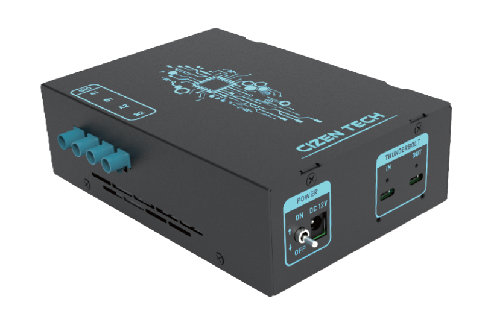

  

  
CIZEN TECH · Technical Support

  <h1 class="cz-hero-title">Frame grabbers &amp; software. From setup to integration.</h1>
  

    Installation, control, image capture and analysis guides for MIG frame grabbers, CameraMaster and the SDK. Find your next step below.
  

  

    <a class="cz-btn cz-btn-primary" href="#/Getting_Started">Get Started →</a>
    <a class="cz-btn" href="#/MIG_Grabber_SDK">Browse the SDK</a>
  

  

  <figure class="cz-hero-visual">
    
MIG SERIES / FRAME GRABBER

    <figcaption><strong>MIG-S6</strong>Capture · Control · Analyze<a href="#/FrameGrabber">Explore the hardware →</a></figcaption>
  </figure>

## What would you like to do?

  <a class="cz-card" href="#/Getting_Started">01 / SETUP
Connect your first board →

Identify your model, install the driver and check your first image.
</a>
  <a class="cz-card" href="#/MIG_Grabber_SDK">02 / DEVELOP
Integrate the SDK →

Find API signatures and C++, Python and C# examples.
</a>
  <a class="cz-card" href="#/Troubleshooting">03 / RESOLVE
Find and report an issue →

Check device detection, video and configuration before contacting support.
</a>

## Explore the docs

  <a class="cz-card" href="#/FrameGrabber">
    
Hardware

    
Frame Grabber

    
MIG-S2 / S2 Pro / S3 / S6 MIPI capture cards — key features, models, and specifications.

  </a>

  <a class="cz-card" href="#/CameraMaster">
    
Viewer

    
CameraMaster

    
Real-time capture, configuration files, bring-up procedures, and the Grabber terminal.

  </a>

  <a class="cz-card" href="#/MIG_Grabber_SDK">
    
SDK

    
MIG Grabber SDK

    
C++, Python, and C# APIs for controlling the grabber from your own application.

  </a>

  <a class="cz-card" href="#/DriverInstallation">
    
Setup

    
Driver Installation

    
MIG-S2 and S6 driver packages, installation checks, and MIG-S3 support guidance.

  </a>

  <a class="cz-card" href="#/CameraMasterFramework">
    
Framework

    
CameraMaster Framework

    
Build custom inspection items with FrameworkBridge and the test-item lifecycle.

  </a>

  <a class="cz-card" href="#/ImageKit">
    
Inspection

    
Image Kit

    
SFR, distortion, defect, blemish, shading — the built-in image-quality test set.

  </a>

  <a class="cz-card" href="#/Deserializer">
    
Hardware

    
Deserializer

    
TI and MAXIM deserializer selection, channel mapping, and terminal commands.

  </a>

  <a class="cz-card" href="#/NVIDIA_Jetson_platform">
    
Platform

    
NVIDIA Jetson

    
Jetson TX2 / Xavier / Orin deserializer boards for GPU-side image acquisition.

  </a>

  <a class="cz-card" href="#/Resolution_Bandwidth">
    
Reference

    
Resolution &amp; Bandwidth

    
Megapixels to pixel counts to link bandwidth — which MIG board and GMSL rate carries each resolution / format / fps.

  </a>

  <a class="cz-card" href="#/Technical_Support">
    
Help

    
Technical Support

    
Reach the engineering team for issues that aren't covered by the docs.

  </a>

## Quick start

  

    
1

    

      
Install the driver

      
Install Visual C++ Redistributable 2015–2022, then the MIG driver matching your board (S2 / S6; contact support for S3). See <a href="#/DriverInstallation">Driver Installation</a>.

    

  

  

    
2

    

      
Install CameraMaster

      
Run the CameraMaster installer and launch the application. The Grabber connection status should turn green.

    

  

  

    
3

    

      
Load a module configuration

      
Pick a <code>.ini</code> file that matches your module / SER / DES / video format and review the contents in CameraMaster.

    

  

  

    
4

    

      
Bring up the camera

      
Power the module, initialize the sensor, and check live video. From here, run inspection items or integrate via the <a href="#/MIG_Grabber_SDK">SDK</a>.

    

  

---

  <strong>CIZEN TECH Co., Ltd.</strong> · 624, 6F, 118 LS-ro 116beon-gil, Dongan-gu, Anyang-si, Gyeonggi-do, Republic of Korea 
  <a href="mailto:sw@cizentech.com">sw@cizentech.com</a> · <a href="https://www.cizentech.com/" target="_blank" rel="noopener">cizentech.com</a>

